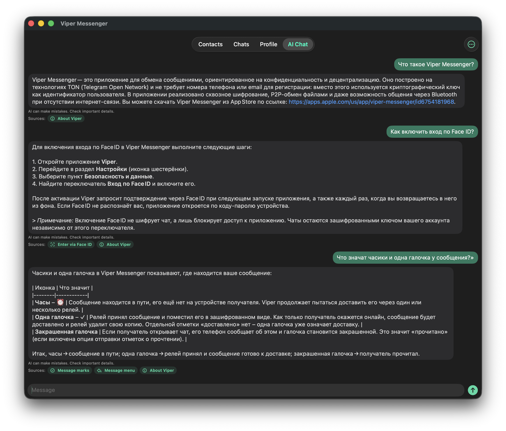

# On-device AI

> The model is fixed. The program around it is not.

Viper has an AI chat that runs entirely on your device — iPhone, iPad or Mac.
No cloud. No AI provider account. Your questions never leave the device.

On iPhone and iPad it runs smaller open models. This page is about the Mac:
gpt-oss-20b, the largest model Viper runs, and the harness around it.

It knows Viper. Ask how keys work, how to move to a new phone, what TON Drop
does — it answers from Viper's own guides and shows where the answer came from.

It can act, too. Ask it to message someone, create an event or save a note, and
it prepares a draft. Nothing is sent until you tap **Send**.

**A stock open model. Viper's harness. Your device.**

**What you see.** AI Chat in Viper on a Mac, offline. Three everyday questions:
what Viper is, how to turn on Face ID login, and what the clock and the single
check next to a message mean. Each answer comes with **Sources**: the in-app
guides it was taken from (*Enter via Face ID*, *Message marks*, *About Viper*).
Tap one to open that guide and check the answer yourself.

**Why it matters.** A messenger's help should not need the internet, an account
with an AI company or a support chat. People ask about keys, delivery marks and
privacy when something feels wrong — often offline, often in a hurry. Viper
answers on the device, from Viper's own guides, and points to the source, so
you can check the answer in one tap. Check it: the answers are not always right
yet — about half are fully correct in our strict test (see
[the numbers](#the-test-1534-vs-1535)), and making them reliable is the work in
progress.

---

## How it started

This page is about a harness, not about weights. But it started with weights.

**[Sparks of Weight-Space Programming](https://rikiyat.github.io/blog/weight-space-programming)**
(MIT CSAIL, Nov 2026) shows that frontier LLMs can read and edit a neural
network's weights much like code. In their example, editing a tiny share of a
small model's weights stopped it from looping in its reasoning: the model could
already solve the problems, something in the weights held it back. Their own
caveat: an edit like this removes what holds a model back; it does not add
abilities the model lacks.

That paper started a week of research for Viper. The question: can we program
a model on the device to know Viper the same way — by changing its weights?

### Step 1: reproduce MIT

We applied MIT's published edit to the same small model (Qwen3.5-0.8B) on our
own Mac. It reproduced: the edited weights matched MIT's byte for byte, and on
30 MATH-500 problems the edited model solved 15, the original 3.

### Step 2: try it for Viper — small models only

Then we tried to *add* something with weights, on small models (0.8B–1.7B),
on one Mac:

- **A weight edit to fix a real bug** (Qwen3.5-0.8B ignoring "Always answer in
  English"). The edit fixed the bug — and broke other things: answers in
  Russian, maths, an app-prompt check. By rules written before the edit, a
  failure.
- **A weight edit against invented facts** (Qwen3-1.7B, made-up biographies):
  no significant change.
- **Training a small model on Viper** (LoRA on
  [BotPsy](https://qvac.tether.io/blog/on-device-ai-agent-botpsy) 0.8B, Tether
  QVAC's tool-calling model, on data built from Viper's guides): worse than
  giving the same model the guides in its prompt.

Zero or negative every time — exactly MIT's caveat. Editing weights can remove
a fault; it did not put Viper's facts into a model.

One limit of this result: it all ran on a single laptop. We did not train on a
GPU cluster, with more data and longer runs. That is worth trying later. For
this work we set one condition: **no training.**

### Step 3: context space, on the final model

The model that ships is different: **gpt-oss-20b, weights exactly as
released.** None of the experiments above touched it.

Instead of changing what the model *is*, Viper changes what it *sees*: the
guide pages for the question, the question split into parts, the actions it may
propose — and then checks its answer in code. The work moved from weight space
to context space. Weight-space programming is on this page because it is where
we started and why we stopped: Viper's facts are something the model lacks,
and lacking is what weight edits do not fix.

---

## No training

Viper does not retrain the model to teach it Viper. Viper builds a *harness*
around an unchanged open model: the knowledge it needs at the moment you ask,
the actions it may propose, and checks that run before every build ships. Swap
in a better model tomorrow, and everything Viper taught it stays.

Or the better model may be Siri. If Siri learns to use apps on its own —
reading the screen and tapping through them — Viper adapts: its own AI chat may
no longer be needed, and we would take it out. If Apple opens Siri to
developers, so apps can use its AI through Siri, Viper will support that and
bring its guides and actions to it.

---

## Nothing new, just engineering

None of the building blocks here are new. Giving a model retrieved documents
at question time (RAG), letting it call tools, and wrapping it in a harness of
prompts and checks are all well known, and used widely. This is not a new way
to train LLMs — there is no training in it at all.

What is Viper's own is the engineering for one app, on macOS:

- **The knowledge:** Viper's in-app guides, rewritten for a model, with menu
  paths taken from the app's code and plain lines for what Viper does not have.
- **The routing:** a question is split into parts, each part finds its guide
  page, and the model picks the lines that answer it.
- **The answer:** the picked guide pages are shown as they are, instead of a
  retelling.
- **The actions:** message, event and note, always as a draft you confirm.
- **The checks in code** and **the blind test** that decides what ships.

---

## Private by design

- The model, the knowledge and your questions stay on your device.
- No API keys, no usage logs on someone else's server.
- The AI proposes; you decide. Every action is a draft until you confirm it.
- You choose what it knows: turn Viper's built-in knowledge on or off, add your
  own notes.

---

## Where it stands

Three kinds of things below: what **works now** in the App Store build, what
is **experimental** (measured on a test bench, not in the app yet), and what is
**planned**.

### Works now: Viper 1.5.34

Viper 1.5.34, now on the App Store, ships gpt-oss-20b on Mac with Viper's
knowledge: when you ask about Viper, the app gives the model the About Viper
card and the two in-app guides that match your question, and the answer shows
those guides as **Sources** (the screenshot above is 1.5.34).

On a small test this worked well: 20 questions about Viper went from 4 right
(the model alone) to 19 right (the model with the guides).

Also in this build: actions as drafts (message someone, create an event, save
a note — nothing happens until you confirm), turning Viper's knowledge on or
off, and your own notes as knowledge.

### Experimental: the 1.5.35 harness

Everything from here to *Planned* is test-bench work: measured, not yet in the
app.

#### We scaled the test

Twenty questions we wrote ourselves is not proof. So we built a large blind
test:

- **Hundreds of new questions**, written by two different authors (another
  open model and us), in Russian and English, in the ways people really ask:
  short, vague, with typos, slang, a situation ("my old phone broke…"), several
  questions at once — and questions about things Viper does not have.
- **Two blind judges** grade every answer against Viper's knowledge. An answer
  counts as *correct* only when both say so, and as *invented* when either one
  finds a made-up feature, menu or number.
- **Fresh questions decide.** A change counts only when it also wins on
  questions no version of the harness has seen.

At this scale the 1.5.34 approach fell short. On fresh situation-style
questions it was right about a third of the time, and invented something in
about a third of its answers. Reading the failures showed why: the model often
had the right guide in front of it and still added things that were not there.

#### What we changed

Still no training — the model's weights are untouched. Only the program around
it changed:

1. **Guides rewritten for the model.** Every guide page became short numbered
   steps with the exact menu path from the app's own code, plus plain lines for
   what Viper does *not* have (no groups, no QR scanner, no cloud sync).
2. **The question is taken apart.** A multi-part question is split into
   sub-questions; each finds its own guide, and the model first picks the guide
   lines that answer it.
3. **Answers come from the guide page itself.** Instead of retelling the guide
   in its own words, the assistant shows the guide pages it picked. When nothing
   fits, it says the guides do not cover it, instead of guessing.
4. **Checks in code**, not in the prompt: the answer's language must match the
   question, a refusal while a matching guide page exists falls back to a normal
   answer, and actions stay drafts.

#### The test: 1.5.34 vs 1.5.35

The same model in three setups, on **fresh questions no version has seen**
(167 Viper questions, two blind judges):

- **Model alone (no harness)** — stock gpt-oss-20b. It knows nothing about
  Viper, and it cannot: **gpt-oss-20b was released in 2025, and Viper Messenger
  appeared on the App Store in January 2026.** The model was finished before
  Viper existed in public, so everything it knows about Viper has to come from
  the harness.
- **1.5.34 (harness)** — now on the App Store: the About Viper card and two
  matching guides.
- **1.5.35 (harness)** — the patch that fixes what this test found in 1.5.34:
  the changes listed above.

| | Model alone (no harness) | 1.5.34 (harness) | 1.5.35 (harness) |
|---|---|---|---|
| Correct | 2% | **41%** | **61%** |
| Correct or partly correct | 11% | **68%** | **89%** |
| Invented something | 57% | **24%** | **4%** |

The model alone cannot know Viper: gpt-oss-20b was released in 2025, and
Viper Messenger appeared on the App Store in January 2026 — after the model was
made. Its few "correct" answers are generic
messenger advice that happens to match Viper (tap a photo, then Share → Save
Image) or an honest "I don't know". On 33 questions about things Viper does
not have, it invented an answer 76% of the time; 1.5.34 6%; 1.5.35 3%.

**Why these numbers look low.** On simple questions 1.5.34 already works, as
the screenshot shows: the answer may not be exact in every detail, but it
points the right way. This test is harder on purpose: varied questions at
scale — slang, typos, situations, several questions at once — and strict
grading: an answer counts as *correct* only when both judges agree that every
Viper detail in it is true.

On the set we studied the failures on (166 questions; higher, because we fixed
the guides where these answers went wrong): 1.5.34 43% correct, 28% invented;
1.5.35 71% correct, 2% invented. We publish it, but count only the fresh set.

*Draft note: 1.5.35 numbers are from the test bench, not yet from the app build.*

#### What it runs on

For now this needs a powerful Mac. Every number on this page was measured on
one laptop:

- **MacBook Pro, Apple M5 Pro** (15-core CPU: 5 super + 10 performance cores;
  16-core GPU), **24 GB** of memory, macOS 26.5.
- The model is **gpt-oss-20b** (MLX, MXFP4), about 12 GB, loaded fully into
  memory.
- **Speed:** the model alone writes about 57 tokens a second and answers a
  question in about 2.6 s (median; 5.6 s for the slowest tenth). The new
  harness asks the model 3–4 times per question (split, find, pick, answer),
  so a full answer takes about 6.4 s (median; 9.9 s for the slowest tenth).

The model itself takes about 12 GB of memory while it runs (13 GB at peak;
11 GB on disk). With macOS and the app on top, 24 GB is comfortable; a 16 GB
Mac is tight. iPhone is not there yet: the largest iPhones have 12 GB in
total, less than the model alone needs.

### Planned

- Pick the right guide page more often — most remaining misses are a missing or
  wrong page, not a wrong answer.
- Ship the new harness in the next build, then measure speed on real devices.
- Publish the test questions and grading rules alongside the results.

Viper's AI chat is available now on iPhone, iPad and Mac. gpt-oss-20b, the model
on this page, needs a Mac with Apple silicon and 24 GB of memory.
[Viper Messenger on the App Store](https://apps.apple.com/us/app/viper-messenger/id6754181968)
